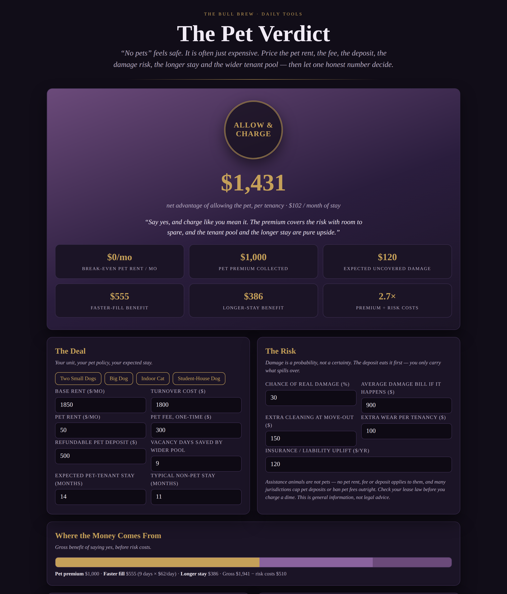

# The Pet Verdict — Should You Allow Pets, and What Should You Charge?

**Live:** https://thebullbrew.github.io/pet-verdict/
**Repo:** https://github.com/thebullbrew/pet-verdict

## What it does

Prices a pet policy honestly for landlords: pet rent, one-time fee and refundable deposit on one side; expected damage (probability × what spills over the deposit), extra cleaning, wear and insurance uplift on the other — plus the two benefits most landlords never price, a wider tenant pool that fills the unit faster and pet tenants who stay longer because moving with a pet is a hassle. You get an ALLOW & CHARGE / ALLOW / CLOSE CALL / KEEP IT PET-FREE seal, the net advantage per tenancy, a break-even pet rent solver, a premium-vs-risk cover ratio, a money-anatomy bar, damage-probability and pet-rent sensitivity tables, 4 presets (Two Small Dogs, Big Dog, Indoor Cat, Student-House Dog), saveable cases, and a copyable summary. On the defaults it lands at ALLOW & CHARGE, +$1,431 per tenancy.

## The method

Premium = pet rent × expected stay + one-time fee. Faster-fill benefit = vacancy days saved × daily rent. Longer-stay benefit = turnover cost × (1 − non-pet stay ÷ pet stay), the turnover you avoid per tenancy cycle when pet tenants stay longer. Damage is priced as an expectation, not a fear: probability × max(0, average damage − deposit), because the refundable deposit eats the damage first and you only carry the spill-over. Net = premium + fill + stay − (expected spill-over + cleaning + wear + insurance over the stay). Break-even pet rent is solved directly from that equation. Assistance animals are not pets, and many jurisdictions cap pet deposits or ban pet fees — check your local law before charging. General information, not legal advice.

## Design

Dark aesthetic variation 11 — Velvet Dusk: purple-black luxury, velvet-violet highlighted panels, antique gold for everything that matters, italic serif pull-quotes for the verdict, soft dramatic shadows.

## How to run

Open `docs/index.html` in any browser, or serve `docs/` with any static host. Works offline as a PWA after first load. No backend, no accounts, no data leaves your device — saved cases live in localStorage.
